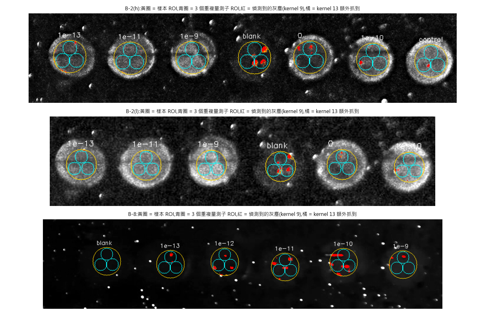
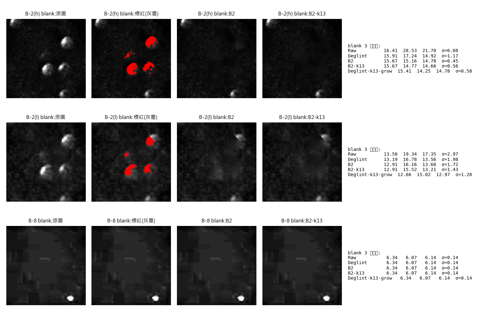
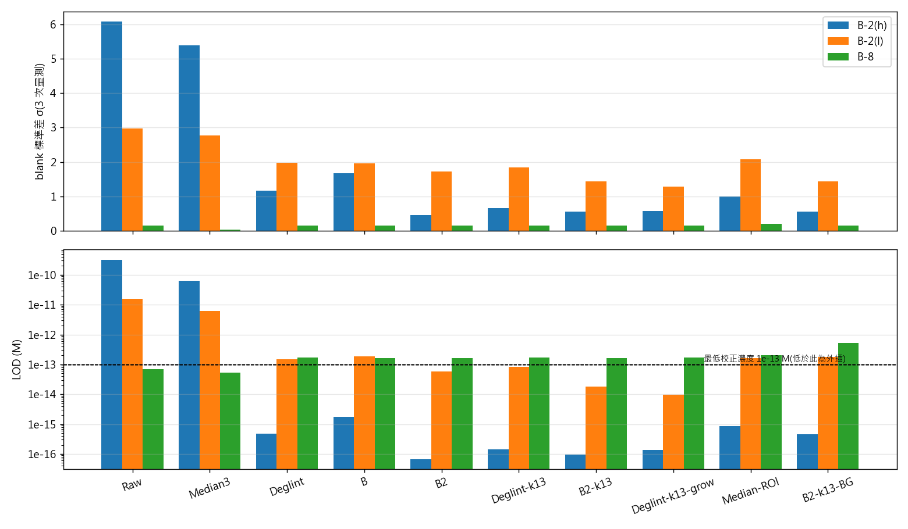
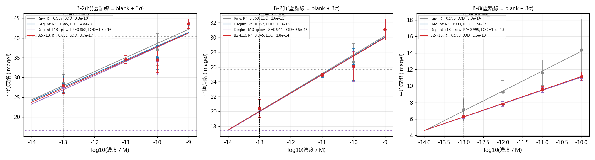

# 以影像處理降低灰塵雜訊對螢光量測與 LOD 的影響

**日期**:2026-10-29
**資料**:`test image/` 內 Chi 20261014 B-1、B-2(h)、B-2(l)、B-8 四張影像,與使用者分析檔 `Chi 數據分析 20261029 Ozzy.xlsx`
**程式**:`lod_analysis.py`(分析)、`make_figures.py`(作圖),處理演算法與量測程式 `20261029.py` 相同

---

## 摘要

實驗室目前沒有無塵室,樣本表面的灰塵與氣泡會在螢光影像上形成小而亮的斑點,把樣本的平均灰階墊高,也讓重複量測的差異變大。本報告以影像處理的方式,**只在樣本 ROI 內**偵測並排除這些亮點,並用和使用者 Excel 相同的流程(半對數校正曲線、LOD = blank + 3σ)比較 10 種處理方式。

主要結論:

1. **灰塵偵測**:用 White Top-hat(形態學)抓出「比 kernel 小的亮點」,門檻用 ROI 內的中位數與 MAD 決定,不受灰塵本身影響。B-2 的灰塵多為直徑約 10 px 的氣泡,**kernel 要用 13**(原本 9 只抓得到氣泡核心)。
2. **建議的量測方式**:**Deglint-k13-grow**,也就是灰塵像素及其外圍 2 px 光暈都「不計入平均」。它不補任何數值,但雜訊降低的效果和「補值」方式(B2)相當。補值的 B2 適合用來做呈現用的圖片。
3. **對雜訊的效果**:有灰塵的樣本,重複量測的標準差明顯下降。例如 B-2(h) 的 blank σ 從 6.08 降到 0.58,B-8 校正點的平均 CV 從 18.5% 降到 3.5%。
4. **對 LOD 的效果**:改善幅度取決於**灰塵是否落在空白樣本上**,以及**重複量測的定義**。以 0 M 樣本為空白、樣本內 3 個位置為重複量測時:
   - B-2(h):LOD 從 **5.4 × 10⁻¹² M 降到 3.3 × 10⁻¹³ M**(約 17 倍)
   - B-2(l):LOD 從 **1.9 × 10⁻¹⁰ M 降到 1.8 × 10⁻¹¹ M**(約 10 倍)
5. **灰塵會造成假訊號**:B-8 的 1e-13 M 樣本,原始平均 7.14,排除灰塵後 6.24,幾乎等於 blank 的 6.19。原始數據的低濃度訊號有一部分是灰塵。所以 B-8 處理後 LOD 沒有變好(7.0e-14 → 1.7e-13),但這個數字比較可信。
6. **需要謹慎的地方**:很多 LOD 算出來低於最低校正濃度 10⁻¹³ M(例如 10⁻¹⁶),這是把校正直線往外延伸的**外插值**,沒有實驗驗證,不應直接寫進成果報告。要宣稱更低的 LOD,需要補做 10⁻¹⁴、10⁻¹⁵ M 的樣本。

---

## 1. 背景與問題

- 量測方式:以相機拍攝各濃度樣本的螢光,取樣本區域的平均灰階當訊號,對 log10(濃度) 做直線擬合,再用空白樣本的「平均 + 3 倍標準差」換算偵測極限(LOD)。
- 問題:影像上有大量灰塵亮點(B-2 上還有較大的氣泡)。灰塵落在樣本 ROI 內時:
  - **平均值被墊高**:落在空白樣本上會讓 blank 偏高;落在低濃度樣本上會造成假訊號。
  - **重複量測差異變大**:3 次量測中有的包含灰塵、有的沒有,σ 跟著變大。
  - LOD 由 `blank + 3σ` 決定,兩者都會讓 LOD 變差或失真。
- 目標:不改變實驗,用影像處理排除灰塵,評估哪一種方式最有效,以及對 LOD 的實際影響。

## 2. 資料與方法

### 2.1 影像與樣本對應

依使用者 Excel 的順序,由左到右:

| 影像 | 尺寸 | 樣本(由左到右) | 校正點(與 Excel 圖表相同) |
|---|---|---|---|
| B-2(h) | 774×162 | 1e-13, 1e-11, 1e-9, blank, 0, 1e-10, control | 1e-13, 1e-11, 1e-10, 1e-9 |
| B-2(l) | 602×140 | 1e-13, 1e-11, 1e-9, blank, 0, 1e-10 | 同上 |
| B-8 | 847×190 | blank, 1e-13, 1e-12, 1e-11, 1e-10, 1e-9 | 1e-13 ~ 1e-10(1e-9 出現下降,Excel 也未納入) |

B-2(h) 與 B-2(l) 是同一片玻璃,只有光強度不同。

**B-1 未納入定量分析**:除了 control 之外,其他 5 個樣本都非常淡,無法可靠定出位置,錯誤的 ROI 會讓結論失真。

### 2.2 灰階與 ROI

- 灰階採用 ImageJ 的 RGB → 8-bit 算法 `(R+G+B)/3`,以便和使用者的 Excel 直接對照。
- 樣本中心:先用中值濾波去掉亮點並模糊,再在每個樣本附近取亮度質心。ROI 為圓形,半徑:B-2(h)、B-8 為 30 px,B-2(l) 為 24 px。
- **驗證**:未處理(Raw)的各樣本平均值與 Excel 的相關係數為 **0.992 / 0.988 / 0.999**,數值也很接近(例如 B-2(h) 的 1e-13:Excel 28.64,本分析 28.57)。代表 ROI 位置與灰階算法和使用者一致。



*圖 1:黃圈為樣本 ROI,青圈為 3 個重複量測子 ROI,紅色為偵測到的灰塵(kernel 9),橘色為 kernel 13 額外抓到的部分。*

### 2.3 重複量測的定義(對 σ 影響很大)

Excel 的 1st / 2nd / 3rd 只有數值,沒有記錄 ROI 是怎麼取的。本報告用兩種定義各算一次:

- **子 ROI(主要結果)**:每個樣本內 3 個不重疊的位置(各為樣本 ROI 半徑的 0.45 倍)。灰塵只落在其中一個位置時,σ 會變大。這比較能反映「樣本表面不均勻、有灰塵」對量測的影響。
- **重畫(參考)**:整顆 ROI 位置偏移 ±3 px 量 3 次,模擬手動重畫 ROI。每次都包含同樣的灰塵,所以 σ 很小,但平均值會被灰塵墊高。

使用者 Excel 的 σ 介於兩者之間。

### 2.4 LOD 計算(與 Excel 相同)

1. 校正曲線:`強度 = m · log10(C) + b`
2. `log10(LOD) = (μ_blank + 3σ_blank − b) / m`,`LOD = 10^log10(LOD)`
3. σ 用樣本標準差(與 Excel 的 STDEV 相同)。

**空白樣本的選擇**:B-2 有「blank」(外觀很暗,疑似沒有探針)和「0」(0 M 目標物)兩種。LOD 的空白應該是「0 M 目標物、其他條件都相同」的樣本,所以**本報告以「0」為主**,「blank」為參考。使用者 Excel 中 B-2(h) 用「0」、B-2(l) 用「blank」,兩者不一致。

### 2.5 比較的處理方式(全部只作用在樣本 ROI 內)

| 方法 | 做法 | 會改變像素值? |
|---|---|---|
| Raw | 不處理(= ImageJ 直接量) | — |
| Median3 | 3×3 中值濾波後取平均 | 是,全部像素 |
| Deglint | White Top-hat(kernel 9)偵測灰塵,灰塵像素不計入平均(程式現行的分數) | 否,只排除 |
| B | 灰塵像素用鄰近顏色補(Telea inpainting) | 是,只有灰塵像素 |
| B2 | B 再處理一次,連灰塵外圍 2 px 的光暈一起補 | 是,灰塵 + 光暈 |
| Deglint-k13 | 同 Deglint,kernel 13 | 否 |
| B2-k13 | 同 B2,kernel 13 | 是 |
| **Deglint-k13-grow** | kernel 13 偵測,灰塵 + 外圍 2 px 光暈都不計入 | 否 |
| Median-ROI | ROI 的中位數(不需偵測的穩健統計) | 否 |
| B2-k13-BG | B2-k13 再扣掉樣本外圈環形區的背景中位數(修正照明不均) | 是 |

**灰塵偵測的原理(White Top-hat)**:對 ROI 做「開運算」(先侵蝕再膨脹),比 kernel 小的亮點會被抹掉,比 kernel 大的樣本本體會保留。原圖減掉開運算的結果,剩下的就是小亮點。門檻 = ROI 內的 `中位數 + 4 × 1.4826 × MAD`;中位數和 MAD 不會被灰塵本身拉高。

**補值來源只用 ROI 內的像素**:B / B2 補值時,圓形 ROI 外接方框的四角(圓外)不當作來源。否則壓在圓周上的灰塵,圓外那半邊沒被標紅,會被延伸進圓內變成白點(IMG_0779 Sample 8、9 的 B2 曾出現此問題,已修正)。

**為什麼要處理光暈**:灰塵周圍那一圈像素被灰塵映亮,但沒超過門檻。只處理灰塵核心(B、Deglint)時會留下淡淡的圓點,所以 B2 和 Deglint-k13-grow 把遮罩往外擴 2 px。

## 3. 結果

### 3.1 灰塵對空白樣本的影響



*圖 2:各影像 blank 樣本的原圖、偵測到的灰塵、B2、B2-k13,右側為 3 個子 ROI 的數值。*

- B-2(h) 的 blank 上有 3 顆大氣泡。原始 3 次量測為 16.41 / **28.53** / 21.70(σ = 6.08),第 2 個子 ROI 剛好壓在氣泡上。處理後三者為 15.67 / 15.16 / 14.78(σ = 0.45)。
- B-8 的 blank 很乾淨,處理前後完全相同(σ = 0.14)。

### 3.2 雜訊(blank σ)與 LOD 總覽



*圖 4:上為 blank 的標準差,下為 LOD(對數尺度;虛線為最低校正濃度 1e-13 M,低於此為外插)。此圖以「blank」為空白。*

- **Median3 幾乎沒有效果**:灰塵和氣泡比 3×3 大很多,中值濾波去不掉。
- **偵測後排除或補值的方法都有效**,其中 kernel 13 加上處理光暈的效果最好(B2-k13、Deglint-k13-grow)。
- **扣背景(B2-k13-BG)沒有幫助**,B-8 的 LOD 反而變差:環形背景區本身也有灰塵與照明變化,扣掉後雜訊增加。

### 3.3 校正曲線



*圖 3:誤差棒為 3 個子 ROI 的標準差,虛點線為 blank + 3σ(以「blank」為空白)。*

### 3.4 主要結果表(子 ROI 定義)

**以「0」(0 M 目標物)為空白**,本報告建議引用的數字:

| 影像 | 方法 | 空白 μ ± σ | LOD (M) | 備註 |
|---|---|---|---|---|
| B-2(h) | Raw | 22.86 ± 3.75 | 5.4e-12 | |
| B-2(h) | **Deglint-k13-grow** | 21.59 ± 2.37 | **3.3e-13** | 落在校正範圍內 |
| B-2(h) | B2-k13 | 22.05 ± 2.67 | 6.3e-13 | |
| B-2(l) | Raw | 18.03 ± 3.46 | 1.9e-10 | |
| B-2(l) | **Deglint-k13-grow** | 17.51 ± 2.70 | **1.8e-11** | 落在校正範圍內 |
| B-2(l) | B2-k13 | 17.78 ± 3.09 | 6.8e-11 | |
| B-8 | Raw(只有 blank) | 6.19 ± 0.14 | 7.0e-14 | 外插;1e-13 的訊號部分來自灰塵 |
| B-8 | **Deglint-k13-grow** | 6.19 ± 0.14 | **1.7e-13** | 1e-13 與 blank 無法區分 |

**完整比較(以「blank」為空白,所有方法)**:

| 影像 | 方法 | 斜率 | R² | blank μ ± σ | 校正點平均 CV | LOD (M) |
|---|---|---|---|---|---|---|
| B-2(h) | Raw | 3.561 | 0.957 | 22.21 ± 6.08 | 6.0% | 3.3e-10 |
| B-2(h) | Median3 | 3.564 | 0.947 | 21.16 ± 5.39 | 6.0% | 6.3e-11 |
| B-2(h) | Deglint | 3.460 | 0.885 | 16.02 ± 1.17 | 5.3% | 4.8e-16 * |
| B-2(h) | B | 3.461 | 0.892 | 16.52 ± 1.67 | 5.3% | 1.7e-15 * |
| B-2(h) | B2 | 3.451 | 0.879 | 15.21 ± 0.45 | 5.5% | 6.8e-17 * |
| B-2(h) | Deglint-k13 | 3.497 | 0.887 | 15.53 ± 0.66 | 5.2% | 1.4e-16 * |
| B-2(h) | B2-k13 | 3.500 | 0.865 | 15.03 ± 0.56 | 5.5% | 9.7e-17 * |
| B-2(h) | Deglint-k13-grow | 3.593 | 0.862 | 14.81 ± 0.58 | 5.4% | 1.3e-16 * |
| B-2(h) | Median-ROI | 3.702 | 0.836 | 15.67 ± 1.00 | 5.1% | 8.8e-16 * |
| B-2(h) | B2-k13-BG | 4.005 | 0.930 | 7.37 ± 0.56 | 7.2% | 4.7e-16 * |
| B-2(l) | Raw | 2.543 | 0.969 | 16.73 ± 2.97 | 5.2% | 1.6e-11 |
| B-2(l) | Median3 | 2.503 | 0.967 | 16.21 ± 2.77 | 5.1% | 6.1e-12 |
| B-2(l) | Deglint | 2.516 | 0.953 | 14.51 ± 1.98 | 4.9% | 1.5e-13 |
| B-2(l) | B | 2.519 | 0.956 | 14.80 ± 1.96 | 4.9% | 1.9e-13 |
| B-2(l) | B2 | 2.498 | 0.945 | 14.22 ± 1.72 | 4.9% | 5.7e-14 * |
| B-2(l) | Deglint-k13 | 2.515 | 0.954 | 14.28 ± 1.83 | 4.9% | 8.2e-14 * |
| B-2(l) | B2-k13 | 2.496 | 0.945 | 13.88 ± 1.43 | 4.8% | 1.8e-14 * |
| B-2(l) | Deglint-k13-grow | 2.505 | 0.944 | 13.55 ± 1.28 | 4.8% | 9.6e-15 * |
| B-2(l) | Median-ROI | 2.571 | 0.937 | 14.00 ± 2.08 | 5.1% | 1.6e-13 |
| B-2(l) | B2-k13-BG | 2.601 | 0.911 | 6.21 ± 1.43 | 7.9% | 1.8e-13 |
| B-8 | Raw | 2.404 | 0.996 | 6.19 ± 0.14 | 18.5% | 7.0e-14 * |
| B-8 | Median3 | 2.374 | 0.998 | 6.01 ± 0.02 | 16.3% | 5.3e-14 * |
| B-8 | Deglint | 1.616 | 0.999 | 6.19 ± 0.14 | 3.7% | 1.7e-13 |
| B-8 | B2-k13 | 1.630 | 0.999 | 6.19 ± 0.14 | 3.8% | 1.6e-13 |
| B-8 | Deglint-k13-grow | 1.611 | 0.999 | 6.19 ± 0.14 | 3.5% | 1.7e-13 |
| B-8 | Median-ROI | 1.667 | 0.999 | 6.22 ± 0.19 | 2.7% | 2.1e-13 |

\* 低於最低校正濃度 1e-13 M,是外插值。完整數據見 `results_lod_sub.csv`、`results_lod_jitter.csv`、`results_lod_blank_choice.csv`。

**重畫定義(參考)**:σ 很小(0.01~0.8),處理前後的差異主要來自 blank 平均被灰塵墊高的部分被去掉。以「0」為空白時,B-2(h) 的 LOD 從 1.4e-14 變成 1.2e-14,B-2(l) 從 1.8e-14 變成 1.3e-14,都只有小幅改善,而且都是外插值。

### 3.5 各樣本數值(建議方法 vs 原始,子 ROI 定義)

可直接放進 Excel 的數據:`data_for_report.csv`。

**B-2(h)**

| 樣本 | Excel(使用者) | 原始 (Raw) | Deglint-k13-grow |
|---|---|---|---|
| 1e-13 | 28.64 ± 0.42 | 28.57 ± 2.23 | 27.48 ± 1.60 |
| 1e-11 | 33.57 ± 0.34 | 34.53 ± 0.94 | 34.54 ± 0.95 |
| 1e-9 | 45.62 ± 3.85 | 43.58 ± 1.21 | 43.58 ± 1.21 |
| blank | 22.00 ± 1.43 | 22.21 ± 6.08 | 14.81 ± 0.58 |
| 0 | 23.06 ± 2.20 | 22.86 ± 3.75 | 21.59 ± 2.37 |
| 1e-10 | 36.59 ± 1.15 | 37.07 ± 3.99 | 34.19 ± 3.55 |
| control | 48.78 ± 1.79 | 44.87 ± 2.93 | 44.02 ± 2.50 |

**B-2(l)**

| 樣本 | Excel(使用者) | 原始 (Raw) | Deglint-k13-grow |
|---|---|---|---|
| 1e-13 | 21.22 ± 0.60 | 20.41 ± 1.20 | 20.34 ± 1.22 |
| 1e-11 | 25.08 ± 0.22 | 24.87 ± 0.25 | 24.87 ± 0.25 |
| 1e-9 | 30.88 ± 3.03 | 31.06 ± 1.42 | 31.06 ± 1.42 |
| blank | 15.44 ± 0.94 | 16.73 ± 2.97 | 13.55 ± 1.28 |
| 0 | 18.52 ± 2.06 | 18.03 ± 3.46 | 17.51 ± 2.70 |
| 1e-10 | 28.22 ± 0.96 | 26.71 ± 2.48 | 26.08 ± 2.02 |

**B-8**

| 樣本 | Excel(使用者) | 原始 (Raw) | Deglint-k13-grow |
|---|---|---|---|
| blank | 6.04 ± 0.10 | 6.19 ± 0.14 | 6.19 ± 0.14 |
| 1e-13 | 6.71 ± 0.15 | 7.14 ± 1.38 | **6.24 ± 0.20** |
| 1e-12 | 8.66 ± 0.25 | 9.27 ± 1.43 | 7.80 ± 0.28 |
| 1e-11 | 11.18 ± 0.34 | 11.60 ± 1.55 | 9.52 ± 0.34 |
| 1e-10 | 13.69 ± 0.35 | 14.37 ± 3.73 | 11.03 ± 0.39 |
| 1e-9 | 12.02 ± 0.16 | 12.45 ± 0.50 | 12.10 ± 0.16 |

### 3.6 只處理 ROI vs 處理整張影像

整張影像一起處理時,門檻由佔大多數的暗背景決定,會被壓得很低,連樣本邊緣的亮環、背景的雜訊顆粒都被當成灰塵:

- B-2(h)(`../20261029_2_whole_B2_K12.png`):即使 K 調到 12,仍標紅 28.7%、修改 59% 的像素,樣本被抹成塊狀。
- IMG_0779(`../img0779_whole_B2_K4.png`、`../img0779_whole_B2_K12.png`):K = 4 會改掉 26.5% 的像素,K = 12 才勉強保留樣本形狀。

**結論:去灰塵只處理樣本 ROI**。這也是量測程式的做法。

## 4. 討論

### 4.1 為什麼去灰塵會影響 LOD

`log10(LOD) = (μ_blank + 3σ_blank − b) / m`,影像處理可能改變式中的每一項:

- **σ_blank**:灰塵只落在部分重複量測上時,σ 變大。排除灰塵後 σ 下降,LOD 降低。B-2 的主要改善來自這裡。
- **μ_blank**:灰塵墊高空白的平均。排除後 μ 下降,LOD 降低。
- **斜率 m**:灰塵若多落在高濃度樣本上,會讓斜率被高估。排除後斜率變小,LOD **上升**。B-8 就是這個情況(斜率從 2.40 降到 1.61)。

所以影像處理**不保證**讓 LOD 變低。它讓量到的數值更接近樣本真正的螢光,LOD 也因此更可信。

### 4.2 灰塵造成的假訊號(B-8)

B-8 的 1e-13 M 樣本,原始平均比 blank 高 0.95(7.14 對 6.19),看起來可以偵測。排除灰塵後只高 0.05(6.24 對 6.19),小於 3σ(0.42),也就是**無法和空白區分**。原始數據對 1e-13 的「偵測」,大部分來自落在該樣本上的灰塵。這是灰塵在低濃度量測中最需要注意的風險。

### 4.3 先前「處理後 LOD 降到 2.59 × 10⁻¹⁵ M」的解讀

先前使用者用處理後影像算出 LOD 2.59e-15 M,與原始的 7.99e-15 M 比較。這個比較有三個問題:

1. **比較的是不同影像**:2.59e-15 來自 B-2(h),7.99e-15 來自 B-2(l)。
2. **公式不一致**:處理後那組只用 blank 平均、沒有加 3σ(只量了 1 次),原始那組有加 3σ。若原始數據也只用 blank 平均,B-2(h) 會得到 8.6e-15,B-2(l) 會得到 5.5e-16。所以差異主要來自公式,而不是影像處理。
3. **影像經過對比放大**:強度從 28.64 變成 106.92、斜率從 3.94 變成 9.94,都是因為量的是對比放大後的展示圖,不是原始影像。線性的對比放大**不會改變 LOD**:設 `y' = a·y + c`,則 μ'、σ'、m' 都乘上 a,b' = a·b + c,代入公式後 a 與 c 互相抵消。

### 4.4 外插問題

LOD 低於最低校正濃度時,代表把校正直線延伸到沒有量過的濃度,並假設那裡仍然維持線性。本分析中:

- 以「blank」為空白時,處理後的 LOD 多落在 1e-16 ~ 1e-17,比最低校正點低 3~4 個數量級,**不可信**。
- 使用者 Excel 中 B-2(l) 的 7.99e-15 也低於 1e-13,同樣是外插值。

要宣稱更低的 LOD,需要實際量 1e-14、1e-15 M 的樣本,確認訊號仍與 blank 可區分。

### 4.5 限制

- 每個濃度只有一張影像,「3 次量測」是同一張圖上的空間重複,不是獨立實驗。
- 結果依賴 ROI 大小、子 ROI 的配置與空白樣本的選擇,本報告已用兩種重複定義與兩種空白檢查,但仍建議用更多獨立樣本驗證。
- B-1 未分析;影像皆為截圖或已轉存的檔案,若有相機原始檔,結果會更可靠。

## 5. 建議

### 成果報告

1. **方法**:「以 White Top-hat 形態學運算偵測樣本區域內的灰塵與氣泡(kernel 13 px,門檻為 ROI 內中位數 + 4 × 1.4826 × MAD),灰塵及其外圍 2 px 不計入平均。」可搭配圖 1、圖 2 呈現。
2. **效果**:以重複量測的變異來呈現最直接、最不受爭議。例如「有灰塵的樣本 CV 由 18.5% 降至 3.5%」、「B-2(h) blank 的 σ 由 6.08 降至 0.58」。
3. **LOD**:引用以「0」為空白、落在校正範圍內的數字。例如 B-2(h) 從 5.4 × 10⁻¹² M 改善到 3.3 × 10⁻¹³ M(約 17 倍),並註明比較的是同一張影像、同一套公式。
4. **不建議引用**:低於 10⁻¹³ M 的外插 LOD,以及 4.3 節中公式不一致的比較。
5. **呈現用的圖片**:用 B2-k13(灰塵補成鄰近顏色),並註明「僅供呈現,量測數值以排除灰塵後的平均為準」。

### 實驗

1. 補做 1e-14、1e-15 M 樣本,讓更低的 LOD 有實驗支持。
2. 每個濃度做 3 片以上獨立樣本或拍 3 張以上影像,σ 才代表真正的實驗變異。
3. 統一用 0 M 目標物樣本當空白,並記錄 ROI 的取法。
4. 拍攝前用吹球清潔表面,並拍一張沒有樣本的背景影像,作為之後平場校正的參考。

### 量測程式

1. **修正讀檔問題**:程式用灰階模式讀 RGBA PNG 時,灰階會被壓成少數幾個值。例如 B-8 只剩 151 種,集中在 0 / 21 / 28;正確讀取 RGB 後有 479 種。需改為先讀 RGB 再換算。
2. **kernel 可調**:目前 kernel 固定為 9,B-2 這類較大的氣泡需要 13。
3. **量測分數加入光暈排除**:對應本報告的 Deglint-k13-grow。
4. **灰階算法選項**:可選擇 ImageJ 的 (R+G+B)/3,方便與實驗室既有數據對照。

## 6. 重現方式

在 `light_intensity` conda 環境執行:

```bash
python lod_analysis.py sub
python lod_analysis.py jitter
python make_figures.py
```

| 檔案 | 內容 |
|---|---|
| `results_lod_sub.csv` / `results_lod_jitter.csv` | 各影像、各方法的斜率、R²、blank、CV、LOD |
| `results_lod_blank_choice.csv` | 以「blank」或「0」為空白的 LOD |
| `results_replicates_sub.csv` / `results_replicates_jitter.csv` | 每個樣本 3 次量測的原始數值 |
| `data_for_report.csv` | 原始 vs 建議方法,可直接貼進 Excel |
| `fig1_roi_layout.png` ~ `fig4_sigma_lod.png` | 報告中的圖 |
